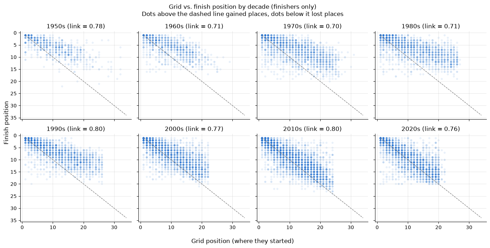
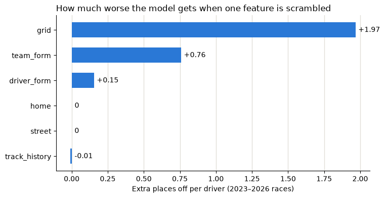

# F1 Analysis: what actually decides a race?

A beginner data-science project on Formula 1 results from 1950 to 2026. It explores the history, tests popular claims with shuffle tests, and builds a model that predicts finishing positions.

## The answer

**Mostly where a driver starts, and the car that got them there.**

- **The grid comes first.** Finishing order follows starting order closely in every decade (a grid-to-finish link of 0.76–0.80 since the 1990s, and 0.70–0.78 before). It's by far the model's most useful feature.
- **The car comes second.** Since 2000, the top team of each decade has won 47–49% of that decade's races, and team form is the model's next most useful feature.
- **The driver's own form adds a little** once the grid and the team are known, though it moves so closely with team form that the model can't cleanly split the car from the driver.
- **The popular stories barely matter.** Grid position isn't more important at Monaco, pit stops haven't gotten faster overall, the home crowd helps in qualifying but not in the race, and there's no clear sign of track specialists.

*Grid vs. finish position by decade (Part 1.4). The closer the dots sit to the dashed line, the more the finish follows the grid.*

The full model beats "finish = grid" across the whole field (2.28 places off against 2.49 on the 2023–2026 races), but not at the front: its pick won 56 of 89 races, against 54 for the pole sitter. Its edge also shrank every season, from 0.50 places per driver in 2023 to 0.03 in 2026. Who wins among the front-runners comes down to things this data doesn't capture.

*What the model relies on (Part 3.5): how many places worse its predictions get when each feature is scrambled.*

The full answer, limitations and next steps are in [`notebooks/05_conclusions.ipynb`](notebooks/05_conclusions.ipynb).

## Key results

| Question | Finding |
|---|---|
| Does the grid matter? | Yes, in every decade: a link of 0.70–0.78 in the 1950s–1980s and 0.76–0.80 from the 1990s on |
| Do retirements still shake up races? | Much less: 48% of starters retired in the 1950s, 12% in the 2020s |
| Does grid position matter more at Monaco? | No: a link of 0.79 at Monaco against 0.78 elsewhere |
| Have pit stops gotten faster? | No, not in total time lost in the pit lane (2011–2026) |
| Is there a home advantage? | Partly: drivers start 0.25 places higher at home, but don't finish any better |
| Are there track specialists? | No clear sign: results at a track are about as spread out as luck alone makes them |
| Can a model beat "finish = grid"? | Slightly: 0.2 places closer per driver over 2023–2026 (not luck), but the edge shrank every season and there's no gain at the front |
| What does the model rely on? | Grid position, then team form, then a little driver form |

## Notebooks

| Notebook | Part | What's in it |
|---|---|---|
| [`01_build_dataset`](notebooks/01_build_dataset.ipynb) | Setup | Joins the raw CSVs into one results table |
| [`02_explore`](notebooks/02_explore.ipynb) | Part 1 | Pole-to-win rates, retirements, dominant teams, grid vs. finish |
| [`03_test_claims`](notebooks/03_test_claims.ipynb) | Part 2 | Shuffle tests of four popular claims, with a findings table |
| [`04_predict`](notebooks/04_predict.ipynb) | Part 3 | A linear model vs. "finish = grid", feature importance, where the model fails |
| [`05_conclusions`](notebooks/05_conclusions.ipynb) | Part 4 | The answer, limitations and next steps |
| [`06_predict_race`](notebooks/06_predict_race.ipynb) | Extra | Type in a race's starting grid and get the model's predicted finishing order |

The plan and progress are in [`OUTLINE.md`](OUTLINE.md).

## Running it

1. Create a virtual environment with Python 3.14 and install the packages: `python -m venv .venv`, then `.venv/bin/pip install -r requirements.txt`.
2. Run `01_build_dataset.ipynb` first. It builds `data/processed/results_joined.csv`, which isn't stored in git.
3. Run the other notebooks in order. They read data with paths relative to the `notebooks/` folder (`../data/...`), so they work wherever the repo is cloned.

## Data

[Formula 1 World Championship (1950 - 2026)](https://www.kaggle.com/datasets/samuelpombourcq/formula-1-world-championship-1950-2026) by Samuel_Pbq on Kaggle, licensed under [CC BY-NC-SA 4.0](https://creativecommons.org/licenses/by-nc-sa/4.0/). The copy in `data/raw/` was downloaded in November 2026, covers races up to the 2026 Mexico City Grand Prix, and is unchanged. It's shared here under the same license.

## How this was made

I built this project with help from Claude Code. It helped write the code and draft parts of the written analysis. I planned the project, made the analysis choices, ran every notebook, and reviewed the results and conclusions.
